


<a href="#about">About</a> &nbsp;•&nbsp; <a href="#built">Projects</a> &nbsp;•&nbsp; <a href="#root">Root Lab</a> &nbsp;•&nbsp; <a href="#stack">Stack</a> &nbsp;•&nbsp; <a href="#activity">Activity</a>

  


I'm a **full-stack developer in Stockholm**. I take a product from the database and backend, through the frontend, to a live server, and keep it running after launch. My work sits close to real operations: a taxi dispatch system used in production, Swedish bookkeeping, and an AI assistant for Swedish law.

After hours I live in `adb shell`, rooting phones and writing **KernelSU · Magisk · APatch** modules and **LSPosed** hooks. 🔧

  

  <a href="https://jurid.se"></a>
  <a href="https://momso.se"></a>
  <a href="https://ringtaxi.nu"></a>
  <a href="https://taxijob.se"></a>

Also built: the <b>La Sani dispatch system</b>, used in production (Python, Node.js, React). Private source, happy to walk through it.

  <a href="https://github.com/ash-iir/trustanycert-adguard-universal"></a>
  <a href="https://github.com/ash-iir/droidspaces-lkm-oneplus13"></a>
  <a href="https://github.com/ash-iir/StrongBypass"></a>
  <a href="https://github.com/ash-iir/android-agent"></a>

  

  
  
  
  
  
  

  
  

  

⭐ If something here helped you root or ship, drop a star. Thanks for visiting!

