  
  
  

### 👨‍💻 About Me

I'm a **full-stack developer in Stockholm**. I take a product from the database and backend, through the frontend, to a live server, and keep running it after launch. My work sits close to real operations: a taxi dispatch system used in production, a Swedish bookkeeping product, and an AI assistant for Swedish law.

After hours I live in `adb shell`: rooting phones, writing **KernelSU / Magisk / APatch modules** and **LSPosed** hooks. 🔧

  

### 🚀 What I've Built

| | Project | What it is |
|---|---|---|
| ⚖️ | [**Jurid**](https://jurid.se) | AI assistant for Swedish law: statute & case search, strategy maps, document analysis (Vertex AI) |
| 📒 | [**Momso**](https://momso.se) | Swedish bookkeeping with receipt matching, invoicing and payroll (Node.js, React) |
| 🚕 | [**Ringtaxi**](https://ringtaxi.nu) | Taxi booking with in-house SMS sending, API integrations, speed & SEO |
| 🧾 | [**Taxijob**](https://taxijob.se) | Shift reports to pay: auto-parsed reports, commission, holiday pay & tax |
| 🛰️ | **La Sani Dispatch** | Dispatch system used in production (Python, Node.js, React), private source |

### 🔧 Root & Android Lab (my hobby)

| Module / Project | What it does |
|---|---|
| 🔐 [**trustanycert-adguard-universal**](https://github.com/ash-iir/trustanycert-adguard-universal) | Universal CA installer for KernelSU/Magisk/APatch, AdGuard cert auto-sync, Android 14+ APEX bypass |
| 🧩 [**droidspaces-lkm-oneplus13**](https://github.com/ash-iir/droidspaces-lkm-oneplus13) | KernelSU LKM for OnePlus 13 (Android 15, kernel 6.6), Droidspaces without touching boot.img |
| 🛡️ [**StrongBypass**](https://github.com/ash-iir/StrongBypass) | LSPosed module for Play Integrity STRONG attestation on rooted devices |
| 🤖 [**android-agent**](https://github.com/ash-iir/android-agent) | AI agent runtime for Android via accessibility services or root |
| 💾 [**VD-Backup**](https://github.com/ash-iir/VD-Backup) | Full app + data backup and restore as root, KernelSU/APatch/Magisk WebUI (fork) |

### 🛠️ Tech Stack

  

  
  
  
  
  

### 📊 GitHub Activity

  
  

  

**⭐ If something here helped you root or ship, drop a star!**

